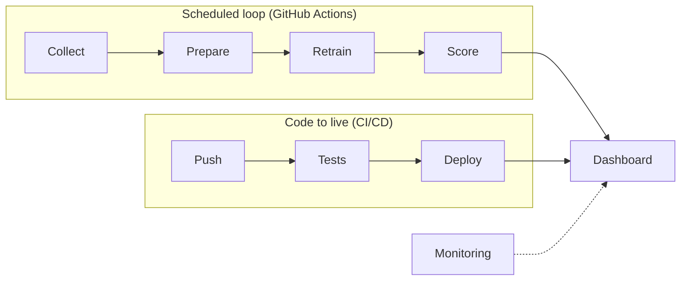

# Ticket Triage

Predicting which open tickets will drag on: a score for the chance each ticket is not resolved within 30 days, using live public data from Apache JIRA.

A learning project: building a production-style ML system end to end (data pipeline, validation, CI/CD, monitoring) on a $0 stack.

## The problem

Software teams keep a queue of bug reports and requests. Some are fixed in a day, others sit for months, and nobody can tell which at the time of filing. This project scores each new ticket with the chance it will drag on, so a team can look at the risky ones first.

## Workflow

- Collect: daily pull of new and changed tickets from JIRA.
- Prepare: features and 30-day labels.
- Retrain: weekly, kept only if better than the current model.
- Score: risk score for every open ticket.
- Dashboard: the queue ranked by risk.
- Monitoring: pipeline health, data drift, accuracy over time.

## Status

Not started.

## License

MIT
