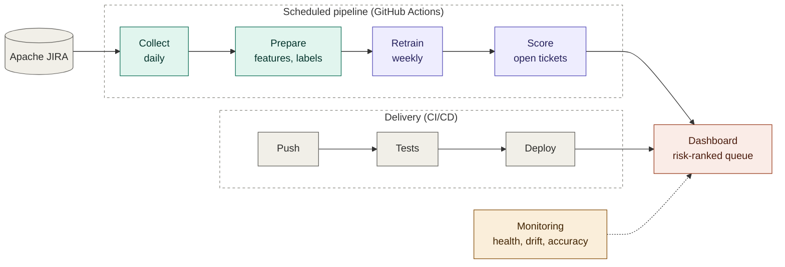

# Ticket Triage

Predicting which open tickets will take longer than 30 days to resolve, using live public data from Apache JIRA.

An end-to-end ML system: a scheduled data pipeline, time-aware validation, CI/CD and monitoring.

## Problem

Engineering and support teams manage queues of bug reports and requests. Some tickets are resolved within days, others remain open for months, and the difference is hard to see when a ticket is filed. Ticket Triage scores each open ticket with the probability that it will not be resolved within 30 days, so a team can review the highest-risk tickets first.

## Data

| | |
|---|---|
| Source | Public Apache JIRA REST API (`issues.apache.org/jira`), no account or key required |
| Projects | Kafka, Spark, Hadoop, Flink, Cassandra |
| Scope | Tickets created since 2022-01-01 |
| Fields used | Project, issue type, priority, components, reporter, title, description, created and resolved dates |
| Freshness | New tickets are created daily; the pipeline refreshes the data on a schedule |

## Workflow

- **Collect:** daily pull of new and changed tickets from JIRA.
- **Prepare:** build features and 30-day labels.
- **Retrain:** weekly; a new model replaces the current one only if it performs better.
- **Score:** risk score for every open ticket.
- **Dashboard:** the queue ranked by risk.
- **Monitoring:** pipeline health, data drift and accuracy over time.

## Approach

- Validation is chronological: models train on earlier tickets and are tested on later ones.
- A ticket is labelled only once it is at least 30 days old.
- Features use only information available when the ticket was created.
- Every model is compared against simple baselines, such as the historical resolution rate per project.

## Status

In development. The data pipeline is the first milestone.

## License

[MIT](LICENSE)
